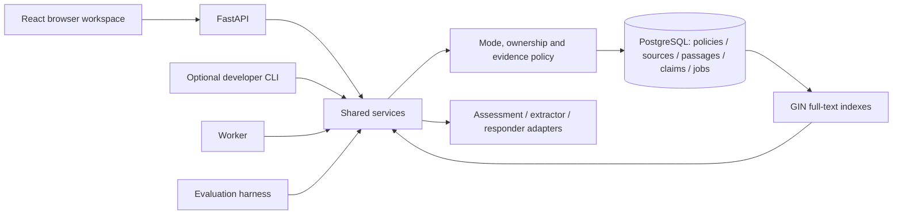
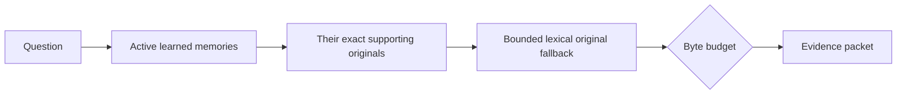

# Architecture

## One application, several entry points

The API, the optional CLI, the worker and every evaluator are adapters around the same service layer.
No client writes around policy. One owner-scoped policy row acts as the serialisation guard for the
whole store: controls, workers, retrieval and answer release all acquire it before committing.

`schema` is managed by Alembic. PostgreSQL runs with two roles — a migration login that owns the
schema and a runtime login with DML only. The API binds to loopback and authorises from a
backend-issued local identity; a submitted `user_id` is never treated as authorisation.

## Evidence representation

The product term is *semantic memory*. In content terms the store holds reusable facts, scoped
preferences and useful reported episodes. Automatic procedural learning is deliberately out of scope.

| Logical record | What it holds |
| --- | --- |
| Source observation | Owner + source key identity, revision, raw/formatted pair, SHA-256, actual import time, nullable supplied capture metadata. Missing metadata stays unknown. |
| Passage | Source revision, variant, zero-based half-open Unicode code-point offsets and the exact text. |
| Claim revision | Subject/entity, predicate, typed value and units, scope, attribution, negation, modality, conditions and explicit-precision time. |
| Claim state | Evidence status (reported / tentative / disputed) kept separate from lifecycle (active / superseded / corrected / excluded). |
| Relations | Evidence-backed `supersedes`, `contradicts`, `conditional_on`, plus source → claim → index dependencies as ordinary rows. |
| Policy / exclusions | Per-owner revision plus the minimal restriction set covering excluded support, dependents, known duplicates and reimports. |
| Jobs / receipts | Idempotency key, attempts, lease, expected revisions, result or fixed error category. |

Two rules follow from this and are enforced in code rather than in prose:

- **Capture time, import time, event time and effective period are different things.** A launch date
  mentioned in a note is not the claim's `valid_from`, and the import timestamp is never promoted to
  a capture time.
- **Identity is not inferred from words.** Equal text from two sources stays two observations; similar
  names do not establish that two people are the same person.

## Turn assessment: retention and answering are separate decisions

Every Normal Ask turn is assessed before it is saved or answered. The assessment returns two
independent structured fields:

- **Retention** — `skip` or `candidate`. A candidate must select exact, unique excerpts of the *current*
  input; extraction later may cite only those spans. A skipped turn is not persisted as a source.
- **Answer route** — `general`, `contextual`, `mixed`, `live`, `clock` or `clarification`.

That independence is what allows one message to contribute a preference while receiving a general
answer with no saved evidence in the prompt. Pure questions, greetings, hypotheticals and
one-response instructions are transient; explicit **Save a note** remains an intentional capture of the
original.

Assessment metadata is request-bound: a lease prevents concurrent duplicate assessment, one schema
repair is attempted, four attempts bound the lifetime, and capture and answer release recheck the
owner, the input hash and the policy revision, so a client cannot reuse another turn's decision.
A completed receipt is reused on retry. Private bypasses this pipeline entirely.

Model output is validated cross-field (references, eligibility, exact spans) before it is used.
A rejected model response is reported as a provider-response failure, never as malformed user input.

## Learning and reconciliation

Saving history and selecting memory are different acts. A source may legitimately yield zero claims.

1. Enforce mode and eligibility before saving or queueing. Eligible user messages and imported
   dictations can teach memory; generated replies cannot corroborate anything; imported instructions
   are data, never executable intent.
2. Preserve raw/formatted variants under one observation. Exact reimport is idempotent; identical
   words from genuinely different observations stay distinguishable.
3. A bounded extractor proposes structured claims with supporting passages, scope and uncertainty.
   It receives enough permitted surrounding context to resolve a pronoun and is never told that a
   name elsewhere in memory is the answer.
4. Code validates schema, ownership, real spans, exclusions and allowed transitions inside the policy
   guard. These checks establish structural validity, not entailment.
5. Reconciliation compares the proposal with related current and historical claims for the same
   subject/property/scope and commits one of: **add**, **support**, **supersede**, **correct**,
   **conflict**, or the non-writing outcomes **no memory**, **duplicate**, **needs clarification**.
6. Claims, evidence, relations, the receipt and the job state commit in one transaction. Work outside
   SQL locks: the model call happens with no transaction held, and the full packet is re-checked
   before commit.

Bounds (deliberately explicit, and failures are visible rather than truncated): 16 operations per
proposal, 32 passages per claim, 64 active context claims, 60,000 serialised input bytes, 4,096 output
tokens, five-minute leases, three lease attempts and at most one repair call per attempt.

## Retrieval and context

- Retrieval ranks **active learned memories first** and brings their complete supporting originals with
  them. A bounded lexical original is added for detail that was never extracted.
- A small collection *may* be reviewed completely, but only within an explicit allowance (50 sources,
  80 memories, 24,000 serialised bytes) and only when the request is genuinely an inventory. A small
  workspace does not become an excuse to dump every note into the prompt.
- The zero-overlap fallback is a bounded diversity sample of compact claims. It is **not** vector
  similarity and the UI does not call it that.
- Larger collections use PostgreSQL cover-density lexical ranking plus at most one counted query
  rewrite. Query-term document frequencies are computed transiently after ownership, revision, capture
  time and exclusion filters; each paired observation contributes once per term.
- Every returned claim carries all of its exact supporting observations. Partial selections report
  `has_more` / `budget_limited`; an oversized record returns `evidence_budget_exceeded` instead of
  being clipped.

Limits: 512 query characters, 100 source and 100 claim candidates, 1–20 primary matches and
1,024–64,000 serialised UTF-8 evidence bytes (default five matches / 24,000 bytes; Ask requests up to
12). These are byte budgets, not token measurements. A query matching more than 10,000 sources
returns an explicit context-limit error.

Publication is a guarded step: `prepare_search` selects under the guard, external work happens with no
lock held, and `release_search` recomputes eligibility and rejects a changed packet before the answer
is serialised. Already-released bytes cannot be recalled — that boundary is stated rather than hidden.

## Answer policy

| Route | Behaviour |
| --- | --- |
| `contextual` | Cited answer from saved evidence; unknown evidence and operational failure are different outcomes. |
| `general` | Model knowledge, explicitly labelled as not from your notes, never cited, never learned. |
| `mixed` | Cited personal facts and uncited general explanation kept visibly separate. |
| `clock` | Calendar dates from the application clock in a validated IANA timezone, zero provider calls. |
| `live` | Current-news/weather/price requests report that no verification tool is configured. |
| `clarification` | Conservative reference handling: a short targeted question, or abstention. |

Citations are shown as a readable source label and a short excerpt; immutable identifiers live in a
closed *Technical reference* disclosure for debugging. The source inspector remains the authoritative
view of the original.

Three things the answer path refuses to do: borrow a general-knowledge claim as if it were a saved
citation, present a superseded value as current, or treat an unavailable search as proof that no
evidence exists.

## Correct, world change and Forget

**Correct** retracts a wrong interpretation. **Record a world change** keeps the old value as history
and adds a supported successor. Both create a new observation with unknown capture time, cancel the
original job as control input, increment the policy revision and invalidate dependent indexes.

**Forget** excludes the selected claim family's supporting observations, dependent claims, known
full-variant copies and literal supporting passages in reimports. Original source inspection remains
available, because overlapping evidence is not the private content itself. The preview discloses the
affected notes before confirmation, and whole affected observations are conservatively blocked — a
choice that can remove unrelated detail, made because unverifiable fuzzy de-duplication would be worse.

Retrieval, source-only fallback, imports, workers and buffered publication all consult the same
exclusion set under the same guard. Lifecycle concurrency is tested with two real PostgreSQL
connections and barriers in both orderings (control-then-worker and control-then-release).

## Private

Private is a transient mode, not a flag on the saved store:

- No personal-memory or history reads, no dictionary/style reads and no backfill.
- No durable content, activity, job, claim, embedding, export, cache or error payload writes.
- Gates run **before** request bodies are parsed, so refused input is never read.
- Browser state is ephemeral; leaving the page or changing mode clears it and rejects late responses.
- The optional direct-chat route sends only the current question to the configured provider, with no
  database session, no stored transcript and no automatic retry. The UI states that the question still
  leaves the machine.

## Providers, consent and allowance

One provider route is configured at a time and there is **no automatic fallback**: a provider failure
is an operational failure, not a reason to answer from another model.

- Every hosted call is behind a default-off consent flag plus an exact data-policy acknowledgement.
  Consent is per surface: source learning, new question wording and Private direct chat are separate.
- The shared persisted ledger stores request and accounted-token ceilings and prior consumption in
  PostgreSQL. Failed calls, repairs and unknown-usage reservations all consume it, and it survives
  restarts. Resetting it to buy more free attempts is explicitly not supported.
- Provider-side billing is not connected. Cost is reported as unknown rather than as a measured zero.
- Prompts, completions and reasoning are absent from application logs; model-call rows keep
  identifiers, usage, model/prompt versions, request hashes and fixed error categories only.

Adapters expose small interfaces (`assess`, `propose`, `answer`) with configured model IDs, prompt and
schema versions, timeouts and usage accounting. Deterministic test doubles implement the same
interface and are always labelled as doubles in results.

## Browser workspace

The React sources in `frontend/` are built by a pinned Node stage into static assets that the Python
image serves. No Node process runs at runtime, and the application container runs as an unprivileged
user.

The workspace is deliberately stateless on the client: no cookies, no local/session storage, no
IndexedDB, no service worker, no analytics, no third-party assets, no external fonts. Saved reads
happen only after an explicit action (Open, Refresh, Search, import), never on startup or on screen
navigation. Responses are `no-store`, the script policy is same-origin without inline scripts, and
Motion is used only for real pending work — answers are revealed after validation rather than
simulated as a token stream.

Mode and collection changes abort pending requests, clear relevant state and reject late results. An
import already accepted under Normal may still commit; cancellation cannot un-write it, and the UI
says so.

## Measurement boundaries

- **Storage** reports owner-scoped source TEXT bytes, JSONB text-serialisation bytes and passage bytes.
  These are payload sizes, not allocated disk or RAM, and exclude metadata and index overhead.
- **Model use** groups settled successes, failures, unknown-usage calls and reservations by model,
  role and allowance. Unknown usage never becomes zero, and a reservation is never reported as
  consumption.
- **Latency** uses monotonic stage durations. Server spans are inclusive and nested; they must not be
  summed, and the browser round-trip is measured separately.
- **Quality** is not inferred from token counts, memory counts or citation-schema validity. Semantic
  review is a separate, explicitly labelled step.

## Schema

Six reviewed migrations, applied in order; the head is `0006_turn_assessment`.

| Revision | Adds |
| --- | --- |
| `0001_bootstrap` | `policies`, `sources`, `jobs`, Alembic version table. |
| `0002_evidence_contracts` | Passages, claim revisions and claim relations with ownership constraints. |
| `0003_memory_processing` | Job leases and receipts, `model_budgets`, `model_calls`. |
| `0004_lexical_retrieval` | The two GIN full-text indexes over paired source text and claim values. |
| `0005_user_controls` | Controls, feedback, source and passage exclusions, control receipts. |
| `0006_turn_assessment` | Request-bound assessment metadata and call references. |

Applied migrations are never edited to change their meaning; a new revision is added instead. The
extension and the two database roles are created once by the postgres init script because installing
pgvector needs elevated privileges that the runtime login deliberately does not have.
