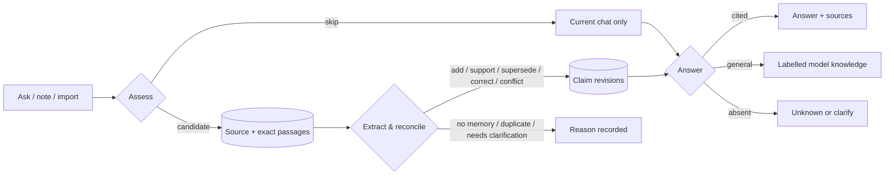

# Jarvis — local-first semantic memory

Jarvis is a personal semantic memory that runs entirely on your machine. You paste in notes,
dictations or exported journals; it decides what is worth remembering, keeps every memory tied to
the exact passage it came from, and answers later questions with citations — or refuses when the
evidence is not there.

The interesting part is not that it remembers. It is that it stays honest about *how* it remembers:
what it learned, from which words, when a fact was superseded rather than deleted, what it forgot
on purpose, and what it never saw at all.

> **The name.** Jarvis is the memory you talk to: the assistant that remembers what you told it and
> shows you where it learned it. The package, the CLI, the settings and the database schema all use
> the same name, so there is nothing to reconcile.

## Why this exists

Retrieval-augmented chat over a pile of notes is easy to demo and hard to trust. The failure modes are
predictable:

- A model paraphrases a sentence into a "fact" and the original wording disappears.
- Two notes disagree, and the newer one silently wins.
- A question is answered from the model's general knowledge while looking like it came from your notes.
- You delete something, and a background worker resurrects it through a copy.
- A "private" mode still writes a log line.

Jarvis is built around those failure modes rather than around the happy path. Every design decision
below exists to make one of them structurally impossible, or to make it visible when it happens.

## What it does

| Capability | Behaviour |
| --- | --- |
| **Capture** | Ask, type or save a note, or import a JSONL collection. Raw and formatted variants of the same dictation stay *one* observation. |
| **Selective learning** | A per-turn assessment decides, independently, whether to retain anything and whether the answer needs context. Questions, greetings, hypotheticals and one-off instructions stay in the chat and are not turned into memories. |
| **Provenance** | Every memory is a revision with typed value, scope, attribution, modality and time, linked to exact code-point spans in the original text. |
| **History** | A correction and a change in the world are different events. Both preserve the earlier state; only one is a retraction. |
| **Retrieval** | Memory-first, memory-attached originals, then a bounded lexical fallback. No embeddings, no vector index — and the docs say so rather than implying semantic search. |
| **Answers** | Cited answers from saved evidence, clearly labelled general knowledge, clock-derived dates, targeted clarification, or an honest abstention. A general answer is never learned. |
| **Control** | Correct, record a world change, and Forget, each with an impact preview and an exact, revalidated commit. |
| **Private** | A transient mode with no saved reads, no durable writes, no caches, no jobs, no browser storage and no backfill. |
| **Measurement** | Per-turn call/token/timing cards, payload sizes, and a persisted provider ledger that survives restarts. |

## How a message becomes a memory



Retention and answering are two separate decisions. That is what lets `I prefer tea. What is
caffeine?` contribute a preference while still receiving a general answer with zero saved evidence
in the prompt.

## Design rules I held to

1. **Sources are canonical; memory is derived.** Claims, indexes and passages are rebuildable;
   the original observation is not. A claim may outlive its usefulness but never silently replaces
   the words that produced it.
2. **Models propose, code commits.** Schemas, ownership, real spans, exclusions and allowed
   transitions are validated in Python. A structurally valid citation is treated as *structurally*
   valid — never as proof of meaning.
3. **State changes are guarded.** One per-owner policy revision orders every write. Leases fence
   workers, receipts fence replays, and answers are serialised at a release point that rechecks
   revocation. A worker that finished after Forget cannot publish.
4. **Conflicts are preserved, not averaged.** Two sources disagreeing about the same property
   produce a disputed state, not a newest-wins guess.
5. **Say what was sent, not what was understood.** The UI reports counts of sources and memories
   placed in the prompt, the payload size and the calls made. Never "the model understood 16 notes."
6. **Every number in the docs came from a command.** Failures, rate limits and abandoned runs are
   kept in `eval/reports/` instead of being rerun until they look good.
7. **Consent is per-surface and default-off.** Sending text to a hosted model requires an explicit
   flag *and* an acknowledgement of that provider's data terms. Private uses its own separately
   gated route, or nothing at all.

## Stack

| Layer | Choice | Why |
| --- | --- | --- |
| Runtime | Docker Compose, Debian bookworm slim base, Python 3.12 | One reproducible Linux path; no host Python/Node needed to *use* it. |
| API | FastAPI + Pydantic | Typed request/response contracts over one service layer. |
| State | PostgreSQL 17 + pgvector, GIN full-text indexes | Transactions, ownership constraints and lexical search in one store. Vectors are installed but unused. |
| Access | SQLAlchemy, psycopg, Alembic | Explicit transactions, separate migration and runtime logins. |
| UI | React 19 + TypeScript, Vite, shadcn/Radix, Motion | Built in a pinned Node stage, served as static assets by FastAPI. No Node process at runtime. |
| Checks | pytest against real PostgreSQL, Playwright/Chromium, Ruff, `uv` lockfile | Isolation and reproducibility before model quality. |

## Quickstart

Prerequisites: Git, Docker Engine in Linux mode, Compose v2, and network access on first build.

```powershell
git clone https://github.com/harshith0518/LocalSemanticMemory.git
Set-Location LocalSemanticMemory
Copy-Item .env.example .env      # then set the three database passwords
docker compose build api
docker compose up -d --wait --wait-timeout 120 api worker
Invoke-RestMethod http://127.0.0.1:8000/ready
```

Open **http://127.0.0.1:8000/** and use **Sources → Try the sample** to import eight synthetic
observations. Import, inspection, lexical search, the controls and the full test suite work with
**no provider key at all**. Live extraction and generated answers require one, plus an explicit
opt-in flag; the exact variables are in [RUN.md](RUN.md#configuration).

## What to try

1. Import the sample collection, then ask a question whose answer is spread across two notes.
2. Inspect a memory and open its evidence — the exact spans are shown against the original text.
3. Correct one memory, then record a world change on another, and compare their histories.
4. Forget a memory and confirm the supporting note no longer feeds retrieval while remaining
   inspectable as history.
5. Ask something the notes do not support and watch it abstain instead of inventing.
6. Ask a general-knowledge question and note that the answer is labelled, uncited and never learned.
7. Switch to Private and confirm that nothing is saved, from either the UI or the database.

## Evidence

These are recorded results, including the bad ones. Full detail and limits live in
[EVALUATION.md](EVALUATION.md); raw artifacts are in `eval/reports/`.

| Check | Result | What it does *not* prove |
| --- | --- | --- |
| Isolated backend suite (real PostgreSQL) | 362 tests, 159.01 s | Model quality — providers are deterministic doubles. |
| Browser journeys (Chromium, isolated DB) | 26 journeys, 48.49 s in the final full run | Cross-browser behaviour; only Chromium is exercised. |
| Retrieval diagnostic, lexical vs lexical+claims | 45/45 answerable attempts returned all required evidence (coverage 1.0); p95 187 ms / 401 ms | Semantic answering — the claims are explicit deterministic fixtures, not live model output. |
| 540-record synthetic corpus, live provider | 365 succeeded (328 extracted, 37 correctly produced no memory), 78 failed, 97 pending | A completed corpus run. It was rate-limited and is reported as partial. |
| 30-question live showcase, run twice | 13/30 then 16/30 mechanical screens, 3 operational failures in the retest, 26/27 returned answers cited every required source | Semantic accuracy. Screens are lexical, and the runs were not frozen-state A/B. |

The recurring theme: **mechanical checks pass long before semantics do.** The evaluation docs are
written to keep those two claims separate.

## Repository map

| Path | Contents |
| --- | --- |
| `src/jarvis/services.py` | Composition root shared by the API, CLI, worker and evaluators. |
| `src/jarvis/turn_assessment.py` | The retention/answer-route decision made before a turn is saved or answered. |
| `src/jarvis/conversation.py`, `processing.py` | Capture, extraction, reconciliation and the guarded commit. |
| `src/jarvis/retrieval.py`, `answers.py` | Bounded evidence selection, answer policy and validated release. |
| `src/jarvis/controls.py` | Correct, world change, Forget, previews, exclusions and idempotency. |
| `src/jarvis/config.py`, `providers.py` | Provider configuration, consent gates and the persisted allowance ledger. |
| `src/jarvis/models.py`, `migrations/` | Schema and the six reviewed migrations. |
| `frontend/src/` | React workspace: conversation, sources, memory, usage, workflow evidence. |
| `tests/integration/` | Contracts against a real, isolated PostgreSQL instance. |
| `tests/browser/` | Chromium journeys against an isolated test backend. |
| `eval/` | Corpus builders, live evaluators, resource measurement and recorded reports. |
| `docs/storage-contract.json` | Machine-readable storage and data-flow index shown in the UI. |

## Documentation

| Document | Purpose |
| --- | --- |
| [ARCHITECTURE.md](ARCHITECTURE.md) | Data model, learning, retrieval, answer policy, privacy and measurement boundaries. |
| [DECISIONS.md](DECISIONS.md) | The engineering choices and the tradeoffs accepted for each. |
| [EVALUATION.md](EVALUATION.md) | Test layers, live runs, recorded results and what remains unmeasured. |
| [RUN.md](RUN.md) | Configuration, browser workflow, developer commands, migrations and troubleshooting. |
| [todo.md](todo.md) | Current status, known gaps and the next useful work. |
| [AGENTS.md](AGENTS.md) | Working agreement for contributors and coding agents. |

## Deliberate non-goals

- **No speech recognition.** Text in, text out; capture-time is never invented from a note's wording.
- **No vector search.** pgvector is installed, but there is no embedding lifecycle, backfill or
  held-out dense evaluation yet, so retrieval is described as lexical and structured.
- **No live web grounding.** Current-news, weather and price questions return an explicit
  "cannot verify" answer instead of a guess.
- **No multi-user deployment.** Authorization is backend-owned, but the shipped identity is a single
  local operator and public deployment would need a separate authentication pass.
- **No background daemon.** Learning happens on the request path or through an explicit action;
  nothing runs while you are not looking.
